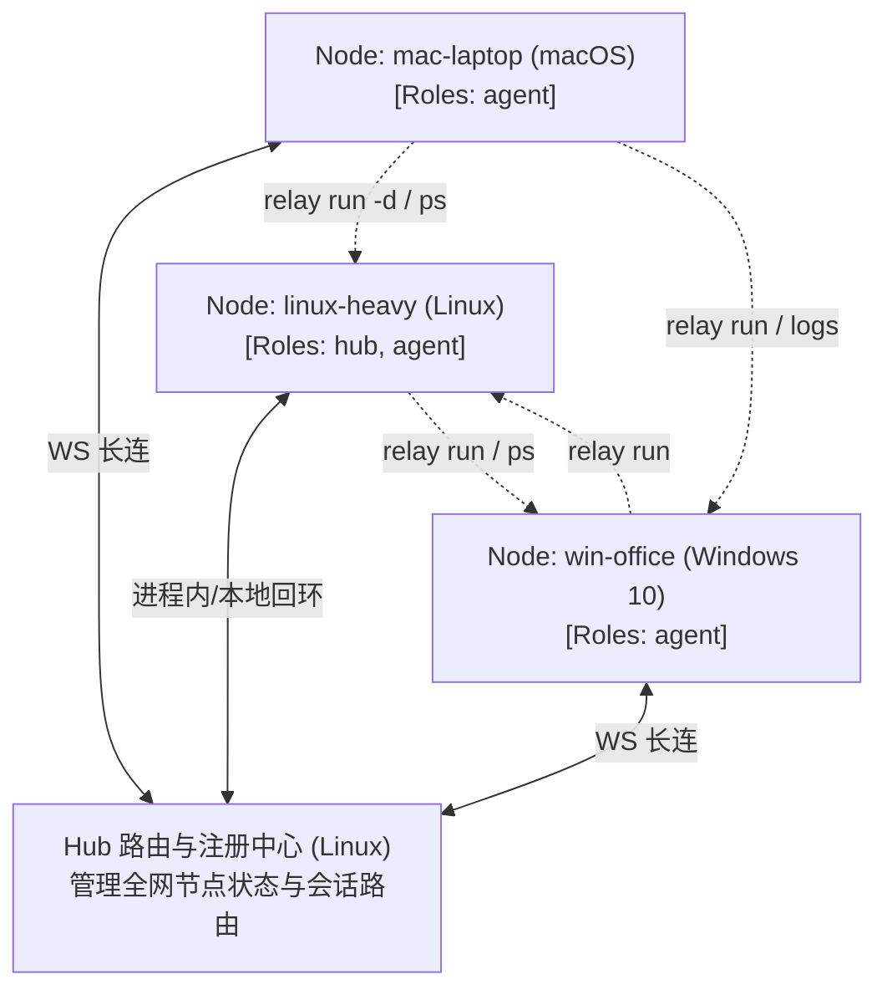

# 逻辑对等节点与分布式算力编排架构需求文档 (Peer/Node Overlay & Distributed Dev Orchestrator)

## 1. Problem Frame & Background (背景与核心诉求)

当前开发者面临的核心硬件与网络痛点：
1. **本机资源严重受限**：主力开发机（如轻薄本 macOS）内存 (RAM) 与 CPU 严重不足，频繁遭遇本地 OOM、风扇狂转或构建超时。
2. **算力闲置且分布异构**：手头拥有可利用的闲置算力资源（如云端/机房 Linux Relay Server、办公室内网 Windows 10 工作站），但这些机器处于异构操作系统中（macOS / Linux / Windows 10）。
3. **老架构角色固化与浪费**：
   - 现有的 `relay server`（Linux）仅充当透明转发中转与文件存储，算力与充裕内存 100% 闲置；
   - 远端 `relay watch`（Windows 10）仅被动接收文件与运行 jobs；
   - 本机 CLI 与中转机、远端机之间心智模型割裂，无法把它们聚合为一个随时调用的“外挂内存与算力池”。
4. **受限网络与无管理员权限约束**：远端机器位于严格深层 NAT 或堡垒机内，无公网 IP，且 Windows 10 机器无管理员权限安装虚拟网卡（TUN 驱动）或 Docker Desktop / WSL2。

本项目在**保持纯用户态单二进制、免 root 权限、单中心 Hub WebSocket 穿透**的前提下，将系统抽象演进为：
**“逻辑对等网络 + 类似 Docker CLI 体验的用户态任务与工作区编排系统”**。

统一底座假定：所有节点在执行层统一以 **POSIX Shell（macOS zsh/bash, Linux bash, Windows 10 Git Bash / MSYS2 `sh.exe`）** 作为命令执行环境。

---

## 2. User Scenarios (典型用户场景)

### 场景一：低配 macOS 本地开发，透明卸载重型编译与服务到 Linux
- 开发者在 macOS 上使用 VS Code 编写 Rust/Node.js 项目。
- 敲下 `relay run -d -e linux-heavy -w myproject --name api-srv "cargo run -- --port 8080"`：
  - 本地自动检测当前 Git 未提交差异（diff + untracked），增量推送到 Linux；
  - Linux 后台启动进程，内存占用转移到 Linux；
  - 开发者通过 `relay ps` 查看状态，`relay logs -f api-srv` 查看实时日志；
  - 开发者执行 `relay tunnel -e linux-heavy`，本地直接访问 `8080` 进行调试，macOS 本机完全不占内存。

### 场景二：任意机器对等控制与跨机调度
- 开发者使用 iPad / 另一台笔记本通过 SSH 连接到云端 Linux 开发机。
- 在 Linux 终端中，自动通过回环与自身 Hub 交互，直接执行 `relay run -e win-office "pytest tests/windows"` 调度远端 Windows 执行测试，或调度自身执行任务。
- 任何节点都是对称的控制端（Controller），无硬件绑定。

### 场景三：工作区同步冲突保护与“永不丢代码”
- 开发者在 Linux 上排查问题临时改了代码，未提交；同时在 macOS 也改了同一个文件并触发 `relay run -e linux-heavy ...`。
- 系统自动检测到远端工作区 dirty 且存在冲突，**默认安全阻断**，防止代码覆写。
- 若开发者指定 `--force-remote`，Linux 在覆盖前自动将现场存为影子快照（`refs/relay/backups/<timestamp>`），事后可通过 `relay undo` 100% 完整复原。

---

## 3. Core Architecture & Conceptual Model (架构与概念模型)

### 3.1 统一节点模型 (Node Overlay)
```
Node ID (全局唯一，如 mac-air, linux-heavy, win-office)
  ├── Initiator (Controller): 任何节点天然具备敲 relay run / ps / logs / stop 的控制能力
  └── Roles (声明的职责能力):
        ├── hub:   是否监听汇聚端口（信令与数据包路由中心，承接原 Server 职责）
        └── agent: 是否接收远程任务、工作区同步与托管（承接原 Watcher/Executor 职责）
```

### 3.2 物理穿透 vs 逻辑全对等控制面
- **物理拓扑**：单/多 Hub WebSocket 长连（客户端与 Agent 单向出站拨号，破除 NAT 与防火墙）。
- **逻辑拓扑**：Any-to-Any 寻址，任何 Node 均可通过 Hub 发起对任意 Node 的控制。



---

## 4. Requirements (具体需求)

### 4.1 Node 守护进程与多角色协同
- **R1. 统一运行入口**：提供 `relay node [run|start|stop|restart|status]`（及别名 `agent`）作为统一常驻守护进程。
- **R2. 角色可插拔配置 (`roles`)**：支持配置 `roles: [hub, agent]` 或 `roles: [agent]`。
  - `hub`: 启动 WebSocket 监听服务；
  - `agent`: 启动命令接收、工作区同步与任务托管。
- **R3. 进程内/回环直连优化**：当节点同时具备 `hub` 与 `agent` 时，守护进程内协同编排，走回环/内存通道，避免网络与端口浪费。
- **R4. 命令行向后兼容**：既有 `relay server` 与 `relay watch` 作为特定 roles 的语义别名平滑保留。

### 4.2 Git Sync-on-Exec 工作区增量同步
- **R5. 100% Git 仓库支持**：工作区依托 Git，执行命令时按需增量对齐。
- **R6. 差异提取与秒级对齐 (Dirty Diff + Patch)**：
  - 执行 `relay run -e <node> -w <ws>` 前，自动提取本地未提交的修改（`git diff HEAD`）；
  - 将受跟踪范围内的未跟踪新增文件打包为内存压缩流；
  - 远端节点收到后调用 `git apply` 并解压新增文件，毫秒级还原现场；
  - 自动天然忽略 `node_modules`、`target`、`.git` 等大目录，无需全量扫描。
- **R7. 影子快照与永不丢代码保障 (Shadow Snapshot & Zero Data Loss)**：
  - 远端在应用 patch 前，若检测到工作区存在未提交改动，自动创建影子引用（`refs/relay/backups/<timestamp>`）；
  - 冲突时默认**严格阻断 (Fail-Safe Reject)**；
  - 支持 `--force-remote` 强制覆盖，并提供 `relay undo` 一键撤销还原。

### 4.3 类似 Docker CLI 的轻量进程与服务管理
- **R8. 前台与后台任务启动**：
  - `relay run -e <node> "<cmd>"`：前台流式回显，退出返回 exit code；
  - `relay run -d -e <node> --name <name> "<cmd>"`：后台托管，分配唯一短 TaskID，重定向日志落盘。
- **R9. 任务状态账本 (`relay ps`)**：
  - 展示全网或指定节点的运行中任务与近期退出历史（Node, Task ID, Command, Status, Uptime, Exit Code）。
- **R10. 实时日志查看与跟读 (`relay logs`)**：
  - `relay logs [-f] [--tail N] <task_id>`：流式跟读任务日志，支持 Ctrl+C 安全退出。
- **R11. 任务生命周期控制**：
  - 提供 `relay stop <task_id>` / `relay restart <task_id>` / `relay rm <task_id>`。
- **R12. 端口转发 (`relay port-forward`)**：
  - 一键将远端任务运行的端口映射至本地回环调试。

### 4.4 拓扑与对称控制
- **R13. 对称控制端 (Symmetric Controller)**：任何节点均可作为 CLI 控制发起端，支持在 Linux 端自动回环访问自身 Hub。
- **R14. 拓扑状态展示 (`relay nodes` / `status`)**：全网节点清单、角色分布、操作系统架构、网络延迟汇总。

---

## 5. Security & Access Control (安全控制)

- **S1. Token 入网鉴权**：共享 Token 控制入网权限。
- **S2. 出口访问控制 (Fail-Closed)**：保持 Agent 节点的 `network_allow` 出口白名单拦截。
- **S3. 工作区沙盒范围隔离**：命令仅在配置的工作区目录内执行。

---

## 6. Long-Term Evolution (长远演进路线)

1. **Multi-Hub 联邦与高可用热备**：节点支持配置多个 Hub 地址，主 Hub 宕机 3 秒内无感漂移切换，消除单点依赖。
2. **局域网自发现与直连 (mDNS Direct Connect)**：同局域网节点通过 mDNS 发现并直连，大流量数据不走外网 Hub。
