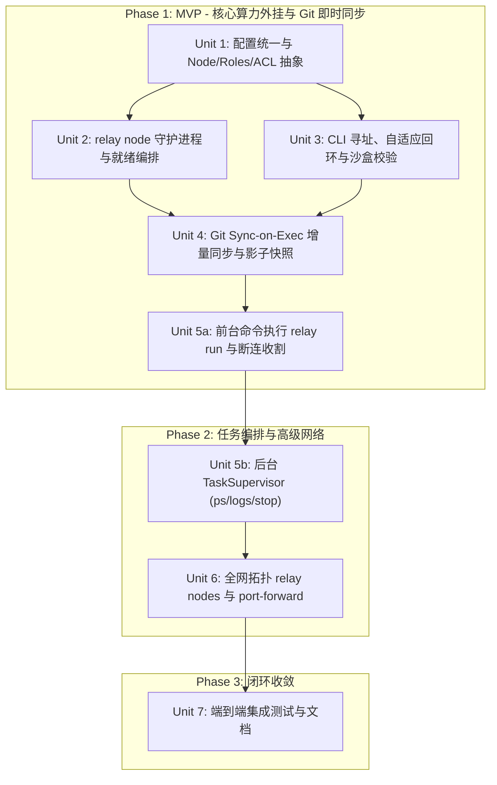

# 逻辑对等节点与分布式算力编排架构实施计划 (Hardened Edition)

## Goal Capsule

- **Objective:** 在纯用户态、免 root 权限、免内核虚拟网卡（Non-Goal 1）的前提下，将 Relay 从割裂的「客户端-中转-执行端」重构为统一的「逻辑对等网络 (Peer/Node Overlay)」。使任意物理机（macOS / Linux / Windows 10）均具备 Node 身份与对称控制能力，Linux Relay Server 可兼任 Hub 与 Agent；引入高可靠的基于 Git 的执行时增量同步（Sync-on-Exec）与影子快照（Shadow Snapshot）防丢代码机制；构建类似 Docker CLI 的轻量进程/服务托管体验（`relay run [-d]`、`relay ps`、`relay logs -f`、`relay stop`），无缝将远端闲置机器的 CPU 与内存扩展为本地可用算力池。
- **Hardening & Defensive Guarantees:**
  1. **Git 健壮性与防穿透**：同步前校验基准 Commit SHA；未跟踪文件解压强制执行 Zip Slip 路径校验并绝对禁止写入 `.git/` 目录；`--force-remote` 走原子 reset 流程；添加 CRLF 宽容参数与二进制 diff 支持；工作区级排他锁（`flock`）。
  2. **跨平台进程树收割**：Windows 10 采用 `taskkill /F /T /PID` 级联终止，Linux/macOS 采用进程组 `syscall.Kill(-pgid)`，杜绝孤儿僵尸进程。
  3. **资源防暴涨 (DoS Guard)**：TaskSupervisor 限制单任务日志上限（50MB 自动轮转保留 3 份）与最大并发任务数。
  4. **对称安全边界**：强制工作区目录沙盒（S3），支持 Node 级 `allowed_controllers` 白名单。
- **Product authority:** 严格承接 [docs/brainstorms/2026-09-18-peer-node-architecture-requirements.md](file:///Users/chentt/Projects/relay/docs/brainstorms/2026-09-18-peer-node-architecture-requirements.md)。
- **Open blockers:** 无。核心架构模型、Git 安全机制、Docker-like UX 与红队防御设计已全数敲定。

---

## Product Contract

### Summary

系统引入全局统一抽象 **Node** 与 **Task**：
1. **Node 身份与多角色**：任何设备拥有全局唯一 `node_id`，按需启用 `roles: [hub, agent]`。Linux 中转机单进程协同承接信令转发与大内存计算，任何节点都可以发起控制，通过 `allowed_controllers` 提供对称防护。
2. **Git Sync-on-Exec 工作区增量镜像**：基于 100% Git 仓库前提，执行前交换基准 Commit SHA，按需提取未提交修改（`git diff --binary HEAD` + untracked 文件打包），秒级在目标 Node 还原现场；绝不扫描或传输 `node_modules`/`target`。
3. **影子快照与永不丢代码保障**：远端应用 patch 前自动生成影子快照（包含未跟踪文件），冲突时默认安全阻断；`--force-remote` 在快照后原子清理工作区并重新应用；提供 `relay undo` 一键无损复原。
4. **类似 Docker CLI 的分期任务管理**：Phase 1 交付核心前台流式执行（`relay run`）；Phase 2 交付后台托管（`relay run -d`）、全网账本（`relay ps`）、日志追踪（`relay logs -f`）、进程树收割（`relay stop/restart/rm`）与端口转发（`relay port-forward`）。

---

### Requirements Traceability (需求追踪矩阵)

| 需求 ID | 需求描述 | 计划落实单元 | 覆盖与防御验证策略 |
|---|---|---|---|
| **R1/R4** | 统一守护进程 `relay node` 与向后兼容别名 | **Unit 2** | 新增 `cmd/relay/node.go`，兼容启动旧版参数 |
| **R2** | 角色可插拔配置 (`roles: [hub, agent]`) | **Unit 1** | `internal/config` 引入 `NodeConfig` 与 `allowed_controllers` |
| **R3/R13**| 双角色回环协同与对称控制端 | **Unit 2/3** | 守护进程就绪锁（Ready Latch），回环 TLS 豁免与自适应拨号 |
| **R5/R6** | Git Sync-on-Exec 增量同步引擎 | **Unit 4** | 基准 Commit 校验，Zip Slip 清洗，`flock` 排他锁，CRLF/二进制宽容 |
| **R7** | 影子快照与冲突阻断（`refs/relay/backups` & `undo`） | **Unit 4** | 影子快照含 untracked 文件，冲突 Fail-Safe，reset 强制覆盖链条 |
| **R8** | 前台与后台任务启动 (`relay run [-d]`) | **Unit 5a/5b** | 5a 负责前台流式（断连自动收割）；5b 负责后台常驻与 PID 托管 |
| **R9** | 全网任务状态账本 (`relay ps [-a]`) | **Unit 5b** | Hub 维护全局 Task 映射，重启自愈元数据 `meta.json` |
| **R10** | 实时日志流式跟读 (`relay logs [-f]`) | **Unit 5b** | WebSocket 增量 tail，日志 50MB 自动轮转防止打爆磁盘 |
| **R11** | 任务停止与生命周期 (`relay stop/restart/rm`) | **Unit 5b** | Windows `taskkill /F /T`，Unix 进程组负 PID 信号，无僵尸泄漏 |
| **R12** | 端口映射 (`relay port-forward`) | **Unit 6** | 显式校验 `network_allow` 回环权限，阻断云元数据 169.254.169.254 |
| **R14** | 全网节点状态展示 (`relay nodes` / `status`) | **Unit 6** | Hub 端汇总并下发全网节点 Roles、OS/Arch 及分段延时 |
| **S1-S3** | Token 鉴权、`network_allow` 与工作区沙盒 | **Unit 1/3/4/5** | 强制工作区目录校验，严禁命令跨目录执行与 `.git/` 篡改 |

---

## Technical Design

### 系统组件与防御边界视图

```
+-----------------------------------------------------------------------------------+
|                              Relay Control Plane (Hub)                            |
|    - Node Registry (Roles/OS/Arch)  - Task Route Indexer  - Auth Guard (Token)    |
+-----------------------------------------------------------------------------------+
       ^ (WebSocket Agent Connection)                     ^ (WebSocket Agent Connection)
       |                                                  |
+------v-----------------------------+     +--------------v-------------------------+
| Node: linux-heavy (Linux x86_64)   |     | Node: win-office (Windows 10 x86_64)   |
| [Roles: hub, agent]                |     | [Roles: agent]                         |
| - Ready Latch & Loopback TLS       |     | - Task Supervisor (taskkill tree reap) |
| - Task Supervisor (PGID -pgid reap)|     | - Rotating Logs (Max 50MB x 3)         |
| - Git Sync (SHA check, flock)      |     | - Git Sync (CRLF tolerant, Zip Slip G) |
| - Workspace Sandbox Verification   |     | - Workspace Sandbox Verification       |
+------------------------------------+     +----------------------------------------+
       ^ (Client Direct/Loopback Control)
       |
+------v-----------------------------+
| Node: mac-laptop (macOS arm64)     |
| [Roles: agent]                     |
| - CLI (relay run / ps / logs)      |
| - Git Diff Extractor (--binary)    |
+------------------------------------+
```

---

## Implementation Units

### Unit 1: 配置层统一与 Node/Roles/ACL 抽象 (`internal/config`)
- **Goal:** 在配置解析层引入 `NodeConfig`、`roles`（`hub`, `agent`）与节点控制白名单（`allowed_controllers`），无缝兼容老版 `server:` 与 `backend:`。
- **Files to touch:**
  - Create: `internal/config/node.go`
  - Create: `internal/config/node_test.go`
  - Modify: `internal/config/config.go`
  - Modify: `config.example.relay.yaml`
- **Approach:**
  1. 定义 `NodeConfig`（`ID`, `Roles`, `HubAddr`, `AllowedControllers []string`, `HubExecEnabled bool`）。
  2. 实现 `Normalize()` 规则：缺失 `node:` 时根据旧字段等价推导；Hub 节点默认开启 Hub，其 `agent` 角色可显式配置。
  3. 提供 `cfg.IsHub()`, `cfg.IsAgent()`, `cfg.GetLocalHubURL()`, `cfg.IsControllerAllowed(nodeID string)`。

---

### Unit 2: 统一守护进程 `relay node` 与就绪协同编排 (`cmd/relay`, `internal/relay`)
- **Goal:** 实现单一常驻守护进程 `relay node [run|start|stop|restart|status]`，单进程协同启动 Hub 与 Agent，消除启动时序竞态与回环 TLS 握手问题。
- **Files to touch:**
  - Create: `cmd/relay/node.go`
  - Modify: `cmd/relay/main.go`
  - Modify: `cmd/relay/server.go`
  - Modify: `internal/relay/server/server.go`
- **Approach:**
  1. 注册 `relay node`（别名 `agent`）子命令。
  2. 在 `Server` 引入 `readyCh chan struct{}`，在 `Serve()` 成功监听端口后闭合该通道。
  3. Agent 启动协程等待 `<-srv.Ready()` 后再拨号本地回环地址；本地回环连接自动配置 `InsecureSkipVerify: true`（若启用 TLS），避免证书域名校验失败。
  4. 捕获中断信号，先下线 Agent，再优雅停止 Hub。保留 `runServer` 与 `runWatch` 为兼容别名。

---

### Unit 3: CLI 统一寻址、自适应回环与沙盒校验 (`cmd/relay`)
- **Goal:** 所有控制命令统一支持 `--node / -e`，在本地运行 Hub 时自动走回环；强制执行工作区沙盒校验（S3）。
- **Files to touch:**
  - Modify: `cmd/relay/main.go`
  - Modify: `cmd/relay/tunnel.go`
- **Approach:**
  1. 规范化 `--node / -e` 参数解析，与 `-w` 工作区协同。
  2. 强制要求所有远程执行命令必须能够定位到一个已配置的合法 Workspace（由 `-w` 显式指定，或由当前工作目录自动匹配）。
  3. CLI 运行在 Hub 所在物理机时，自动连接 `127.0.0.1:<hub_port>`。

---

### Unit 4: Git Sync-on-Exec 增量同步与影子快照安全网 (`internal/sync/git`, `internal/relay/backend/`)
- **Goal:** 执行前高可靠增量同步 Git 工作区，引入 Commit SHA 校验、Zip Slip 清洗、未跟踪全量快照与 CRLF/二进制兼容。
- **Files to touch:**
  - Create: `internal/sync/git/sync.go`
  - Create: `internal/sync/git/snapshot.go`
  - Create: `internal/sync/git/sync_test.go`
  - Modify: `internal/relay/protocol/message.go`
  - Modify: `internal/relay/backend/relay.go`
  - Modify: `cmd/relay/main.go`
- **Approach:**
  1. **基准比对**：同步前两端比对当前 HEAD Commit SHA；若分叉，Fail-Safe 阻断并提示对齐。
  2. **本地打包**：执行 `git status --porcelain`，通过 `git diff --binary HEAD` 提取变更，将未跟踪且未被 ignore 的文件（单文件 <= 10MB，总计 <= 50MB）压缩为 tar.zst 内存流。
  3. **工作区排他锁**：远端操作加 `flock` 与 mutex 互斥，防止并发 `index.lock` 冲突。
  4. **影子快照（含未跟踪文件）**：若远端 dirty，调用 `git stash push -u -m "relay-shadow-<timestamp>"` 并记录引用为 `refs/relay/backups/<timestamp>`。
  5. **Zip Slip 与 `.git/` 严厉防护**：解压未跟踪文件时，强制检查目标路径必须以工作区根路径为前缀，绝对禁止创建或写入 `.git/` 内的文件，拒绝越界软链接。
  6. **补丁应用与覆盖链条**：
     - 若指定 `--force-remote`：先执行 `git reset --hard HEAD` 清理工作区，再应用补丁；
     - 远端调用 `git apply --ignore-whitespace --whitespace=nowarn`，抹平 Windows CRLF 与 Linux LF 差异。
  7. 提供 `relay undo -e <node> -w <ws>` 恢复最近一次影子快照。

---

### Unit 5a (Phase 1 MVP): 前台命令执行与流式管道 (`cmd/relay`, `internal/relay`)
- **Goal:** 落地基础核心调用命令 `relay run -e <node> -w <ws> "<cmd>"`，联动 Unit 4 自动增量同步，支持客户端断连自动收割。
- **Files to touch:**
  - Create: `cmd/relay/run.go`
  - Modify: `cmd/relay/main.go`
  - Modify: `internal/relay/backend/relay.go`
- **Approach:**
  1. 注册 `relay run` 前台命令：在执行前调用 Unit 4 同步逻辑，同步成功后直接通过 `ExecStream` 管道流式执行。
  2. 客户端断连策略：若前台命令执行期间 WebSocket 断连，远端自动向正在运行的进程发送中断信号收割，防止产生无主孤儿。

---

### Unit 5b (Phase 2): 远端 Task Supervisor 与 Docker 风格任务管理 (`cmd/relay`, `internal/relay`)
- **Goal:** 实现后台任务托管（`relay run -d`）、全网账本（`relay ps`）、实时流式日志（`relay logs -f`）与跨平台进程树收割（`relay stop/restart/rm`）。
- **Files to touch:**
  - Create: `internal/relay/task/supervisor.go`
  - Create: `internal/relay/task/manager.go`
  - Create: `internal/relay/task/supervisor_windows.go`
  - Create: `internal/relay/task/supervisor_unix.go`
  - Create: `cmd/relay/task.go`
  - Modify: `internal/relay/protocol/message.go`
  - Modify: `internal/relay/server/server.go`
  - Modify: `cmd/relay/main.go`
- **Approach:**
  1. **跨平台进程树收割**：
     - Unix 端：`SysProcAttr.Setpgid = true`，停止时调用 `syscall.Kill(-pgid, SIGTERM/SIGKILL)`；
     - Windows 端：通过 `taskkill.exe /F /T /PID <pid>` 级联终止整棵进程树。
  2. **日志安全与轮转**：stdout/stderr 追加至 `~/.relay/tasks/<task_id>/output.log`，单文件超 50MB 自动轮转（保留最多 3 个历史切片）；Agent 限制最大并发后台任务数（默认 16）。
  3. **TaskID 路由与自愈**：TaskID 格式规范为 `<node_id>:<short_hash>`（如 `linux-heavy:7f3b8a`），Hub 天然可寻址；元数据持久化在 `meta.json`，Agent 重启时核验 PID 存活并自愈状态。
  4. **全生命周期命令**：实现 `relay run -d`, `relay ps [-a]`, `relay logs [-f] [--tail N]`, `relay stop`, `relay restart`, `relay rm`。

---

### Unit 6: 拓扑状态展示与端口转发安全联动 (`cmd/relay`, `internal/relay`)
- **Goal:** 实现 `relay nodes` 展示全网节点拓扑，实现 `relay port-forward` 一键映射远端服务端口到本地并严格检查 `network_allow`。
- **Files to touch:**
  - Create: `cmd/relay/portforward.go`
  - Modify: `cmd/relay/main.go`
  - Modify: `internal/relay/server/server.go`
  - Modify: `internal/relay/protocol/message.go`
- **Approach:**
  1. `relay nodes`（或 `relay status`）：Hub 端记录每个已注册 Agent 的 NodeID, Roles, OS, Arch，响应全网节点拓扑。
  2. `relay port-forward -e <node> <local_port>:<remote_port>`：复用 Tunnel 通道，Agent 端强制校验 `network_allow` 放行 127.0.0.1 端口，默认硬拦截云实例元数据 IP `169.254.169.254`。

---

### Unit 7: 端到端集成验证与文档更新
- **Goal:** 编写跨平台（macOS、Linux、Windows 模拟）端到端集成测试，验证 Git 同步、影子快照撤销、任务管理与端口转发，更新文档。
- **Files to touch:**
  - Create: `internal/relay/backend/task_e2e_test.go`
  - Modify: `README.md`
  - Modify: `AGENTS.md`
- **Approach:**
  1. 集成测试覆盖：基准 commit 分叉阻断、CRLF 补丁应用、影子快照 `relay undo` 还原、Windows `taskkill` 进程收割、日志截断轮转。
  2. 更新文档：系统定位升级、新版 Docker 风格 CLI 快速上手与配置指南。

---

## Sequencing & Phasing



1. **第一阶段 (Phase 1 - MVP):** 完成 Unit 1、2、3、4、5a。立刻打通从轻薄本 macOS 向 Linux/Windows 外挂运行重型命令，Git 增量修改毫秒级同步，影子快照 100% 兜底。
2. **第二阶段 (Phase 2 - 进阶托管):** 完成 Unit 5b、Unit 6。实现类 Docker 的后台常驻托管、`relay ps` 账本、`logs -f` 流式 tail、进程树清理与端口转发。
3. **第三阶段 (Phase 3 - 工业级交付):** 完成 Unit 7。全链路端到端自动化测试回归与多平台文档更新。
