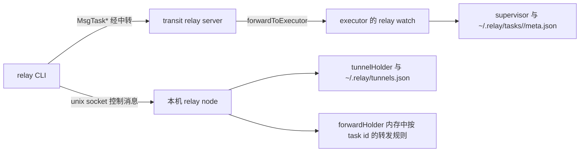
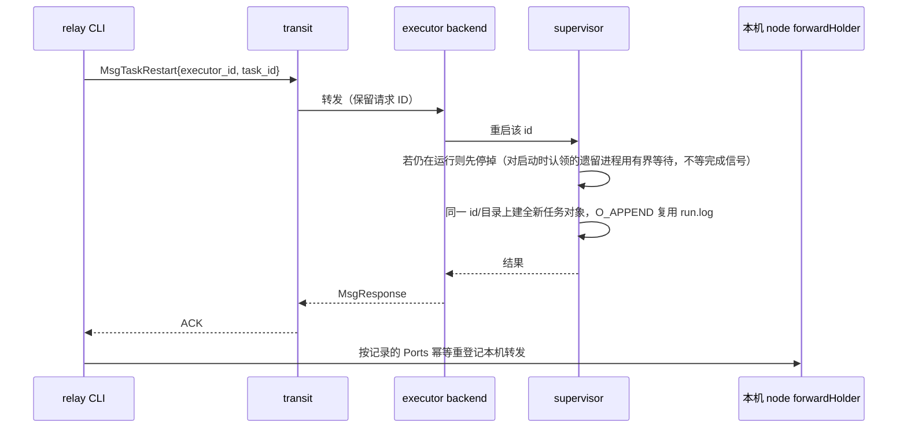
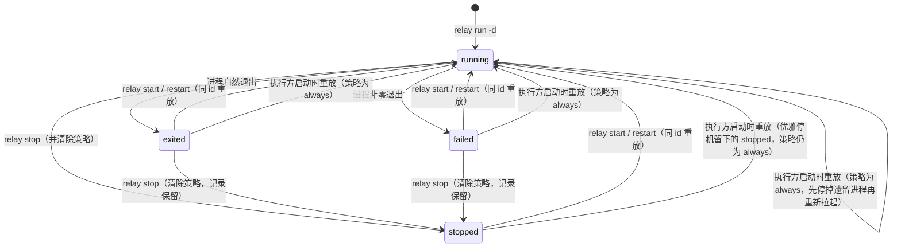

# Unified Object Lifecycle - Plan

## Goal Capsule

- **Objective:** 一台机器上跑着的长命对象（后台任务与 SOCKS5 隧道）用同一组动词、按同一个名字被管理：能列、能起、能重开、能停、能看日志；被停掉的东西不会自己回来。
- **Means:** 按 docker CLI 的语义分层 —— `relay run` 负责创建，`start`/`restart`/`stop`/`logs` 只操作已经存在的对象（KD2），两类对象各自由自己的持久化意图驱动重开（KTD1–KTD10）。
- **Authority:** 本计划的 Requirements（R1–R21）与 Key Decisions 决定行为；Planning Contract 的 KTD 决定实现机制；两者冲突时 R 在前。
- **Stop conditions:** 若实现中发现"同 id 重启"无法在保存原目录与端口的前提下完成，或执行方启动重放会破坏既有任务数据，停下来报告，不要另起机制绕过。
- **Execution profile:** 8 个单元按依赖顺序推进，U2→U1→U3 是执行方侧内核，U4→U6a→U6 是 CLI 面，U7 收尾。
- **Who finishes:** 本计划交付到实现与本地验证为止；发布与推送不在范围内。

---

## Product Contract

### Summary

把两条各自演化的生命周期收敛成一条：`relay run` 创建对象（任务照旧，隧道改用 `relay run -t tunnel`），根级 `relay start|restart|stop|logs` 按名字操作已存在的任务或隧道，任务获得与隧道对称的 `--restart=always|no` 策略，`relay stop` 之后对象不再自行复活。`relay tunnel` 子命令命名空间整体退役。

### Problem Frame

现在管一个后台任务要在四个地方来回跑：`relay run` 建、`relay ps` 看、`relay stop` 停、`relay logs` 看日志；隧道则在旁边自成一套 `relay tunnel start/stop/restart`。停掉的任务没法重开 —— 只能回头把整条命令重敲一遍，尽管执行方早就把命令、工作目录和端口记在 `~/.relay/tasks/<id>/meta.json` 里了。两侧对"停"的理解也不一致：隧道的 `stop` 是删掉意图（docker rm），任务只是杀进程，于是带 `always` 的任务会在执行方下次启动时悄悄复活。`-p` 与 `--listen` 两个旗标表达的其实是同一件事（在本机发布一个端口），却分属两个命令。

### Requirements

**统一寻址与动词**

- R1. `relay start|restart|stop|logs` 均按对象名寻址（task id 或 egress），任务与隧道共用同一组动词；`relay start` 从不创建对象，名字不存在时报错并给出创建方式提示。
- R2. `start` 作用于已在运行的对象时不重启它、不报错，但仍按 R13 补登记缺失的本机转发规则；`stop` 作用于已停止的对象时同样不报错，且 R7/R18 定义的效果照常生效（清策略、移除意图）。取的是 docker「对已停止对象再操作一次不算失败」的语义，不能读成整条命令提前返回。
- R3. 同一个名字同时命中任务与隧道时按任务优先解析，沿用 `runLogs`/`runStop` 既有顺序。
- R4. 任务侧动词在目标执行方离线或中转不可达时报错并以非零码退出；只有该执行方在线、或用户用 `-e/--executor` 指明时，错误里才带它的 executor id，否则说明「该执行方可能离线、可用 `-e` 指定」。不把「查不到」说成「不存在」，也不在此时提示重建。隧道侧动词在本机 node 未运行时降级并在答复里说明原因，不静默。

**任务的 restart 策略**

- R5. `relay run -d --restart=always|no`（默认 `no`）把策略写入任务元数据；`--no-restart` 是 `--restart=no` 的快捷方式，复用既有校验器。该旗标要求 `-d`：前台执行没有可承载策略的受管任务，带它时直接报错，不静默忽略。
- R6. 恢复事件只有一个：执行方进程启动时，策略为 `always` 的任务被自动重新运行。进程自身崩溃不触发任何自动重跑。
- R7. `relay stop <task-id>` 杀掉进程组并清除该任务的策略，记录与日志保留。因此带 `always` 的任务被停掉后不会自己回来。
- R8. 重放或重启失败时（工作目录已不存在、命令找不到等）任务保持停止状态，并把原因追加进该任务自己的日志。

**同 id 重启**

- R9. `relay restart <task-id>` 保持同一个 task id 与同一个任务目录，重跑记录中的命令与工作目录。
- R10. 重启只重放命令、工作目录与端口；首次运行携带的环境、shell 选择与 git diff 同步不重放，工作区按当前状态使用。
- R11. 重启先停掉仍在运行的实例（含执行方崩溃后遗留的存活进程），再以新进程重新开始。
- R12. 元数据保留首次创建时间，重启只更新最近一次启动时间；`relay ps` 的 CREATED 不因重启而重置。

**端口转发一致性**

- R13. `start`/`restart` 按任务记录的端口**连同绑定主机**重新登记本机转发规则（幂等：同一任务、同一地址视为复用而不是冲突）。因此 `stop` 之后再 `start`、或本机 node 重启之后再 `start`，已发布的本地端口都能按原绑定面恢复可用。
- R21. 任务元数据里的端口记录必须无损往返：`stop` → `start` 之后重新登记的绑定主机与端口，与首次创建时完全一致；不允许因为记录里只留了展示用字符串而把绑定面静默收窄回环。

**隧道创建入口与命名空间**

- R14. `relay run -t|--type=tunnel -p <[host:]port> -e <egress> [--restart=always|no]` 创建隧道；隧道模式恰好接受一个 `-p`，没有默认值，也不接受远端半段。
- R15. `-p` 在任务模式新增 `host:port` 形态（绑定主机 + 本地端口），既有四种形态的语义与行为不变。
- R16. 隧道模式下与任务语义冲突的旗标（`-d`、`--no-sync`、`-f`、`-w`）以及位置命令参数一律报错，不静默忽略。
- R17. `relay tunnel` 子命令命名空间退役；非 loopback 监听的告警在新建入口上照旧打到调用方 stderr。

**本机 node 未运行时的如实汇报**

- R18. `relay stop <egress>` 在 node 未运行时同样移除 `tunnels.json` 中的意图；两条 stop 路径共用一个实现，不允许再次分叉。
- R19. node 未运行时 `relay logs <egress>` 依据意图文件确认该 egress 存在，报"node 未运行"而不是"没有这个任务或隧道"；`relay ps -a` 仍列出意图文件中的隧道，标为 `stopped`。

**清单呈现**

- R20. `relay ps` 的任务行显示 restart 策略，复用现有的 `restart` 字段。

### Key Decisions

- KD1. 任务与隧道共用一组生命周期动词，按对象名寻址。`(session-settled: user-directed — chosen over 只统一 stop、把 start/restart 留在隧道命名空间: 两套动词正是要被消掉的那处重复)`. Governs R1, R3.
- KD2. 采用 docker CLI 的分层：`run` 创建、`start`/`restart`/`stop`/`logs` 只操作已存在的对象，`start` 不创建。`(session-settled: user-directed — chosen over 让 run 与 start 互为别名: 别名会抹掉"创建"与"操作已有对象"的区分，start 将无对象可指)`. Governs R1, R2, R14.
- KD3. 任务支持 restart 策略，语义对齐隧道的 `--restart=always|no`，恢复事件只有执行方启动。`(session-settled: user-directed — chosen over 让任务没有策略: 隧道已有的策略本就该对称过来)`. Governs R5, R6.
- KD4. `relay restart <task-id>` 保持 task id 不变。`(session-settled: user-directed — chosen over CLI 用记录中的命令重发一次: 后者会生成新 id，任务身份与端口转发规则都会断)`. Governs R9.
- KD5. `relay stop <task-id>` = 杀进程 + 清策略，记录与日志保留，停掉的对象不再自行复活。`(session-settled: user-directed — chosen over docker 的"手动停的容器在守护进程重启后仍会回来": 与隧道侧"stop = 不再回来"的既有语义对称，且避免进程被停后又自行复活)`. Governs R7, R18.
- KD6. 隧道创建收敛到 `relay run -t|--type=tunnel`，`relay tunnel` 命名空间退役。`(session-settled: user-directed — chosen over 保留 relay tunnel start 作为唯一创建动词: 只剩一个动词的命名空间不如并进创建动词)`. Governs R14, R17.
- KD7. 隧道模式下 `-p` 恰好一个、无默认值、只接受 `[host:]port`。`(session-settled: user-directed — chosen over 保留 --listen 的 1080 默认值与远端半段: "不写就不发布端口"在两个模式下应当一致)`. Governs R14, R16.
- KD8. `-p` 成为唯一的"在本机发布端口"旗标，并新增 `host:port` 形态。`(session-settled: user-directed — chosen over 保留独立的 --listen: 两个旗标表达的是同一件事)`. Governs R14, R15.
- KD9. `relay stop <egress>` 的意图移除缺口并入本计划修复。`(session-settled: user-directed — chosen over 拆成独立修复: 与动词收敛是同一处代码)`. Governs R18.

### Success Criteria

一条带 `--restart=always` 的任务在 `relay stop` 之后不再复活；`stop` → `start` 之后本地已发布端口重新可用；执行方重启后 `always` 任务自动回到运行态，且 `relay ps` 里它的 CREATED 不变；`relay tunnel` 从 help、shell 补全与文档中消失且没有悬挂引用。

### Scope Boundaries

- 隧道与任务的**读取面**不再新增命令：清单只有 `relay ps`，日志只有 `relay logs`。
- 不改动隧道的 `network_allow` 校验与中转侧的 `tunnel_enabled`/`max_tunnels` 门控。
- 不做跨版本协议兼容：全机队同版本升级是既有立场，新消息要求两端一起更新。
- 不建进程崩溃看护（自启、守护、指数退避重试）——"崩溃自动拉起"与被停后"启动时重放"是两件事。
- 不新增 PID 归属校验：按记录中的 PID 终止进程组是今天 `relay stop` 已有的边界，本次不扩大也不修（PID 被回收时可能误杀，属既有风险）。
- 不新增 CLI 侧的 task→执行方索引（像 `tunnels.json` 那样给任务再存一份身份映射）：执行方离线时"查不到该任务"是真实的信息缺失，本次用如实措辞（R4）应对，不再引入一份可能与执行方台账漂移的状态。

#### Deferred to Follow-Up Work

- 任务记录与目录的清理动词（`rm` 类）：本次不提供，`~/.relay/tasks` 与 `relay ps -a` 会持续累积。
- `relay logs -f` 跨重启继续跟随：重启会换掉底层任务对象，跟随流在重启边界结束，需要重新执行才能看新实例。
- 本机 node 的崩溃看护与自启（`docs/plans/2026-10-12-001-feat-tunnel-into-node-plan.md` 也已列为后续）。

### Acceptance Examples

- AE1. 给定一个带 `always` 策略的任务正在运行，当执行 `relay stop <task-id>`，则其进程组被杀、策略被清为 `no`、记录与日志保留；执行方随后重启时该任务不被重放。Covers R7, R6.
- AE2. 给定一个曾用 `-p 8080` 创建、之后被 `relay stop` 停掉的任务，当执行 `relay start <task-id>`，则该任务以同 id 重新运行，且 `127.0.0.1:8080` 重新可连；同一场景换成 `-p 0.0.0.0:8080` 创建时，恢复后的监听仍在 `0.0.0.0` 上。Covers R9, R13, R21.
- AE3. 给定一个 `--restart=no` 的隧道处于 `stopped`，当执行 `relay restart <egress>`，则它按记录的监听地址重新运行，意图条目保留。Covers R1, R14.
- AE4. 给定本机 node 未运行且 `tunnels.json` 里有 `always` 条目，当执行 `relay stop <egress>`，则意图被移除、node 下次启动不重放它；同一状态下 `relay logs <egress>` 报"node 未运行"而不是"没有这个任务或隧道"。Covers R18, R19.

---

## Planning Contract

### Key Technical Decisions

- KTD1. 新增一条一次性协议消息 `MsgTaskRestart`，逐处镜像 `MsgTaskStop` 的现有触点（消息类型常量与请求结构、中转转发分支、客户端请求侧与入站会话、后端接口与实现、执行方 handler），请求结构带 `ExecutorID` 供中转路由；答复只回 ACK，不携带状态。`(session-settled: user-directed — chosen over 让 CLI 用 MsgExec 重发记录中的命令: 后者会生成新 task id，与 KD4 冲突)`. 依据 R9。
- KTD2. 同 id 重启在 supervisor 内以"同一个 id、同一个目录上的**全新**任务对象"实现：新的完成信号、以 `O_APPEND` 重新打开同一个 `run.log`、保留 `Ports`。复用内存中已有的任务对象会让 `logs -f` 立刻返回，因为其完成信号早已关闭。依据 R9, R11。
- KTD3. 任务元数据新增两个字段：restart 策略与首次创建时间。首次创建时间在重启时保持不变，`StartTime` 表示最近一次启动。依据 R5, R12。
- KTD4. 重放每进程只触发一次，且挂在执行方进程的启动路径上（`runWatch`/`runNode` 启用执行方角色之后），以 supervisor 目录为键的进程级 once 守卫；`enableExecutor` 只保留 handler 注册，不承担重放。现在 supervisor 是惰性构造、只被入站请求唤起，所以启动路径要显式构造它一次；而执行方在运行中会反复构造 backend（命令轮询每轮一次、文件事件各一次），把重放挂在构造上会让每个 `always` 任务每 2–30 秒被杀一次，直接违背 R6。依据 R6。
- KTD5. `start`/`restart` 都幂等地重新登记该任务记录中的本机转发规则（对已在运行的对象也照做，见 R2）；幂等由 `forwardHolder` 侧保证 —— 同一 task id 命中同一地址时视为复用，而不是当成"该地址已被别的转发占用"报冲突。本机 node 的转发规则存在内存里且被 `relay stop` 显式注销，所以"id 不变⇒规则仍然有效"只在本机 node 一直活着且没停过时成立；不重登记就会出现"任务回来了、端口是死的且没有报错"。依据 R13。
- KTD6. `-p` 的两种语法走各自的解析路径：任务模式扩展现有 `parsePortForwardSpec` 的两段式（首个元素非纯数字即视为绑定主机，与三段式既有判定一致）；隧道模式用一条只解析 `[host:]port` 的独立路径。隧道的监听地址没有"远端端口"这一半，硬塞进 `PortForwardSpec` 的本地→远端模型只会制造无意义的字段。依据 R14, R15。
- KTD7. `relay run -t|--type=tunnel` 靠 `runExec` 内一个早于工作区/执行方解析的分支实现；位置命令参数在 kingpin 层改为可选、由代码按模式校验（隧道模式必须没有命令，任务模式必须有）。依据 R14, R16。
- KTD8. 名字解析与 node 未运行时的降级共用一个 helper（先任务清单、再 holder、再读意图文件），`relay stop` 的两条路径也共用同一个实现，避免 R18 那类分叉再次出现。依据 R3, R18, R19。
- KTD9. 端口记录以解析后的结构随执行请求上行并落进任务元数据（绑定主机在内），`PortForwardSpec` 的字符串形式只用于展示。现在的记录是 `String()` 的产物，而它从不输出绑定主机，于是 `-p 0.0.0.0:8080` 与 `-p 8080` 记录成同一个字符串，重登记时按默认绑定解析会把发布面悄悄收窄回环。依据 R21, R13。
- KTD10. 重放按**策略**判定，不按进入时的状态：`exited`／`failed`／`stopped` 都在执行方启动时重放，只有被显式 `relay stop` 清掉策略的才不重放（执行方优雅停机留下的 `stopped` 策略仍在，仍要重放）。对执行方崩溃后遗留的存活进程，重放先停掉它再以受管进程重新拉起 —— 认领一个不属于本进程的进程既拿不到它的日志管道，也无法得知它何时退出。依据 R6, R7, R11。

### High-Level Technical Design

两类对象归属不同的守护者，唯一共享的是 CLI 面与 `relay ps` 那张表：

`relay restart <task-id>` 的端到端路径（KTD1、KTD2、KTD4、KTD5 在这一条上会合）：

任务状态与动词的对应关系。重放只看**策略**，不看进入时的状态：`exited`／`failed`／`stopped` 都会在执行方启动时被重放，唯一不重放的是策略已被清除的那个 `stopped`（只由显式的 `relay stop` 产生）。执行方优雅停机留下的 `stopped` 策略仍在，因此仍会被重放 —— 这正是 `relay node restart` 之后 `always` 任务要回来的那条路径。

`relay run` 的模式与旗标矩阵（KTD6、KTD7 定死的行为，实现按此校验）：

| 输入 | 任务模式（默认） | 隧道模式（`-t tunnel`） |
|---|---|---|
| 位置命令参数 | 必需 | 报错（R16） |
| `-p 8080` | 本地 8080 → 远端 8080 | 监听 8080，绑定取 `--bind-host` |
| `-p 127.0.0.1:8080` | 绑定 127.0.0.1 + 本地 8080 → 远端 8080 | 监听 127.0.0.1:8080 |
| `-p 8080:9000` | 本地 8080 → 远端 9000 | 报错（隧道没有远端半段） |
| `-p` 给多次 | 允许 | 报错（R14） |
| `-p` 缺失 | 允许（不发布端口） | 报错（R14） |
| `-d` / `--no-sync` / `-f` / `-w` | 有效旗标 | 报错（R16） |
| `-e/--executor` | 目标执行方 | 出口执行方（同义） |
| `--restart` / `--no-restart` | 写入任务元数据（R5） | 写入隧道意图（R14） |

### Implementation Constraints

- 两类对象的重开都由各自的持久化意图驱动，谁也不共用对方的存储：任务用执行方的 `meta.json`，隧道用本机 node 的 `tunnels.json`。
- CLI 只对本机 node 的隧道状态拥有一个合法写入点（node 未运行时的意图移除，R18），其余一律走 `~/.relay/tunnel.sock` 控制消息。
- 退役命名空间时不得连带删除共享代码：`isLoopbackAddr`（`portforward.go`、`forward_holder.go` 在用）、SOCKS5 握手与连接泵（`tunnel_holder.go` 在用）、以及隧道日志子系统（`relay logs <egress>` 在用）。
- 新增动词必须沿用现有的"降级不崩"姿态：远端查询失败只告警，本机侧能做的照做。

### Sequencing

U2 → U1 → U3 建立执行方侧能力：先有 supervisor 的同 id 重启（U2），协议消息（U1）才有可调用的落点，两者一起构成启动重放（U3）的前提。U4 备好 `-p` 的两套解析，U5 用它们开出隧道的创建入口，U6a 把解析结果无损地送进任务记录与简报（U6 的端口恢复要按记录里的完整规格重登记），U6 把根级动词与名字解析接上（依赖 U1 的协议、U4 的解析与 U6a 的记录），U7 在一切就位后退役旧命名空间并同步文档，避免中间态留下无人引用的命令。

### Risks & Dependencies

- **协议与服务端同版本。** 新消息对老执行方是不可识别的，调用方只会在自己的超时后失败。缓解是部署时两端一起更新（既有立场），并保证请求带超时而不是无限等待（U1）。
- **元数据格式变更。** 新增字段对既有任务目录是可选缺省：缺策略按 `no` 读，缺首次创建时间则回退到最近启动时间，因此不需要迁移脚本（U2、U3）。
- **执行方自动重放、或本机 node 重启时，已发布的本地端口不会自己回来。** 本机转发规则只存在于 node 内存里：重放发生在执行方侧，node 重启则整张规则表消失，两者都只由 CLI 的 `start`/`restart` 重建（KTD5）。所以一个 `always` 任务在执行方重启后自己回到运行态，而它当初发布的本地端口需要再执行一次 `relay start <task-id>` 或 `relay restart <task-id>` 才恢复；`relay ps` 的 PORTS 列显示的是记录中的意图，不保证本机此刻真的在监听。这是本次接受的边界：让本机 node 感知执行方的重放事件属于另一套机制，列入后续工作。
- **端口记录必须无损，否则恢复会静默改变发布面。** 见 R21/KTD9：记录里若只留展示字符串，`0.0.0.0` 这类绑定会在 `stop` → `start` 后悄悄退回回环，而 `relay ps` 前后显示一致、看不出变过。

---

## Implementation Units

### U1. 新增 `MsgTaskRestart` 协议消息全链路

- **Goal:** 让 CLI 能请求执行方"按记录重跑某任务"，并拿到一个明确的成功/失败答复。
- **Requirements:** R9
- **Dependencies:** U2
- **Files:**
  - `internal/relay/protocol/message.go`（消息类型常量、请求结构）
  - `internal/relay/server/client.go`（转发分支）
  - `internal/relay/client/client.go`（入站分发）
  - `internal/relay/client/exec.go`（请求侧调用与入站会话）
  - `internal/relay/backend/relay.go`（执行方 handler 注册与实现）
  - `internal/backend/backend.go`（后端可选接口）
  - `internal/relay/backend/relay_test.go`
  - `docs/relay-protocol.md`
- **Approach:**
  1. 按 `MsgTaskStop` 的现有触点逐处添加（KTD1）：常量与请求结构（结构里必须带 `ExecutorID`，中转靠它路由）、中转的转发分支、客户端的请求侧调用与入站会话、后端可选接口与实现、执行方 handler。
  2. 一次性请求应答，不走向 `MsgTaskLogs` 的流式路径。
  3. 请求必须由调用方传入带超时的 context，与既有 `TaskStop` 调用点一致，避免老执行方不认识该消息时调用方无限等待。
  4. 非 relay 后端维持既有的"不支持"报错路径。
  5. 在 `docs/relay-protocol.md` 补上该消息的请求/应答说明。
  6. 执行方侧的 handler 调用 U2 交付的同 id 重启入口；U2 未落地前，这个单元的端到端用例预期为红。
- **Execution note:** 先写一条会失败的端到端集成测试钉住请求/应答契约，再补实现。
- **Patterns to follow:** `MsgTaskStop` 的全链路实现与 `internal/relay/backend/relay_test.go` 的 in-process hub 模式。
- **Test scenarios:**
  - 对运行中的任务发出重启请求，收到成功答复且任务随后处于运行态。
  - 对不存在的 task id 发出请求，收到失败答复且错误信息可读（不挂起）。
  - 带 `ExecutorID` 的请求被中转路由到指定执行方；目标是另一个执行方时不误投。
  - 执行方离线时调用方在超时内收到错误而不是一直等待。
- **Verification:** 端到端测试证明请求/应答可往返；`docs/relay-protocol.md` 中能找到该消息。

### U2. supervisor 的同 id 重启与元数据扩展

- **Goal:** 执行方能按记录把某个任务在**原 id、原目录**上重新跑起来，且重启不丢失身份信息。
- **Requirements:** R9, R10, R11, R12
- **Dependencies:** 无
- **Files:**
  - `internal/supervisor/task.go`
  - `internal/supervisor/supervisor.go`
  - `internal/supervisor/supervisor_test.go`
- **Approach:**
  1. 在同一个任务目录上构造全新任务对象（KTD2）：新的完成信号、`run.log` 以追加方式重新打开、沿用记录中的命令/工作目录/端口。
  2. 重启前先处理仍在运行的实例：仍在运行则先停掉，并**用有界等待**确认它已退出（对启动时认领的遗留进程不能等完成信号 —— 那个信号只在本进程启动的任务上才会关闭），超时后再以新进程开始；记录里的进程已不存在则直接以新进程开始。
  3. 元数据增加 restart 策略与首次创建时间（KTD3）；首次创建时间只在第一次创建时写入，重启时保持。
  4. 重启前校验工作目录仍然存在，缺失时返回可读错误而不是把原始的系统错误抛给用户。
- **Execution note:** 现有 supervisor 测试已覆盖持久化与跨进程恢复；先补同 id 重启的特征化用例，再改结构。
- **Patterns to follow:** `StartTaskWithPorts` 的创建路径（日志打开、shell 解析、进程组准备）与 `loadExistingTasks` 的存活校准。
- **Test scenarios:**
  - 对一个已退出的任务重启：id 与目录不变，状态回到运行态，`Ports` 保留。
  - 对一个正在运行的任务重启：旧进程组被终止，新进程启动，只有一个进程在跑。
  - 对一个执行方崩溃后遗留的存活进程重启：有界等待后新进程启动，调用不会无限阻塞，也不会同时跑两个实例。
  - 重启后元数据里的首次创建时间不变，最近一次启动时间被更新。
  - 工作目录已被删除时重启：返回可读错误，任务保持原状态，日志不受损。
  - 重启后 `run.log` 保留重启前的内容（追加而非截断）。
- **Verification:** 新用例覆盖上述分支；既有 supervisor 用例全部保持通过。

### U3. 任务的 restart 策略：写入、显式停止时清除、执行方启动时重放

- **Goal:** 任务创建时能带策略；策略为 `always` 的任务在执行方进程启动时自动回到运行态；被显式停掉的任务策略被清除、不会自行复活；重放失败不阻塞执行方启动，且失败原因可查。
- **Requirements:** R5, R6, R7, R8
- **Dependencies:** U2
- **Files:**
  - `cmd/relay/main.go`（`relay run` 的策略旗标与校验）
  - `internal/relay/protocol/message.go`（执行请求携带策略；任务简报新增策略与首次创建时间）
  - `internal/backend/backend.go`（任务简报字段）
  - `internal/relay/backend/relay.go`（策略透传、任务简报映射、启动重放的触发）
  - `internal/supervisor/supervisor.go`
  - `internal/supervisor/task.go`
  - `internal/supervisor/supervisor_test.go`
  - `internal/relay/backend/relay_test.go`
- **Approach:**
  1. `relay run` 增加 `--restart=always|no`（默认 `no`）与 `--no-restart`，并要求 `-d`（R5）。取值校验抽成一个不依赖隧道旗标变量的纯函数 —— 隧道命名空间退役后这条校验还要独立可用。
  2. 策略随执行请求到达执行方，写入任务元数据（KTD3）。
  3. 重放由执行方进程的启动路径触发一次（KTD4）：在 `runWatch`/`runNode` 启用执行方角色之后显式构造 supervisor 并执行重放，用进程级 once 守卫去重；`enableExecutor` 只注册 handler。重放按 KTD10 判定 —— 只看策略，不看进入时的状态。
  4. 单个任务重放失败时把原因追加进该任务的日志并让它保持停止，其余任务继续。
  5. 策略清除只发生在**显式的入站停止**（`relay stop` 对应的那条消息的 handler）里（KD5）。执行方自身的优雅停机走 `StopAll()`，它只把状态写成 `stopped`、绝不动策略 —— 否则每次 `relay node restart` 都会把所有 `always` 清成 `no`，R6 静默失效。
  6. 元数据里的策略与首次创建时间要随任务简报上行（`handleInboundTaskList` 的映射一并补齐），否则 CLI 侧没有可显示与可判定的字段。
- **Execution note:** 先在集成层验证"执行方启动即重放"，且要包含"优雅停机留下的 `stopped` 也被重放"这条；再补"单个任务失败不影响整体"与"显式停止清除策略"的用例。
- **Patterns to follow:** `tunnelHolder.restore()` 对 `always`/`no` 的分流与失败留痕；隧道侧策略取值校验的分支结构。**不要**把策略清除挂到 `relaybackend.Cleanup()` / `StopAll()` 这条停机路径上，也不要把它写进 `Task.Stop()`。
- **Test scenarios:**
  - 执行方启动后，策略为 `always` 的已退出任务自动处于运行态，策略为 `no` 的任务保持退出态。
  - 执行方优雅停机（走 `StopAll`）后再启动：策略仍为 `always` 的任务被重新拉起 —— 停机只写 `stopped`，不碰策略。
  - 策略为 `always` 的任务退出码为 0 时，执行方下次启动仍重放它（与 docker 一致，不做退出码门控）。
  - 执行方崩溃后遗留的存活进程：重放先停掉它再重新拉起，且不会同时存在两个实例。
  - 带 `always` 的任务被显式停止后，元数据里的策略变为 `no`，且执行方下次启动不重放它。
  - 某个 `always` 任务因工作目录缺失无法重放：该任务保持停止、原因出现在它的日志里，其他 `always` 任务照常被拉起。
  - 执行方启动时没有任何任务目录：正常启动，无错误。
  - `--restart` 取非法值、或在前台执行（无 `-d`）时带上它：都报错，不创建任务。
- **Verification:** 集成测试覆盖"启动即重放（含优雅停机后的 `stopped`）"、"单个失败不阻塞"与"显式停止清除策略"；`relay ps` 能看到策略与 CREATED。

### U4. `-p` 的两种语法

- **Goal:** 同一个 `-p` 旗标在两种模式下都表达"在本机发布一个端口"，且各自的失败方式明确。
- **Requirements:** R15, R14, R16
- **Dependencies:** 无
- **Files:**
  - `cmd/relay/portforward.go`
  - `cmd/relay/portforward_test.go`
- **Approach:**
  1. 任务模式的两段式扩展为：首个元素是纯数字则按"本地端口:远端端口"解析，否则按"绑定主机:本地端口"解析（与三段式既有的判定规则一致）。
  2. 隧道模式按独立路径解析（KTD6）：只接受 `[host:]port`，返回绑定主机与监听端口；不接受远端半段。
  3. 隧道模式下给出针对性的错误文案，说明隧道只需要 `-p <[host:]port>`。
  4. 既有四种形态的解析结果保持不变。
  5. 解析结果要能被记录无损带走（R21、KTD9）：任务模式下上行的是完整规格（含绑定主机），`String()` 只用于展示。
- **Patterns to follow:** 现有 `parsePortForwardSpec` 的分支结构与 `portforward_test.go` 的表驱动风格。
- **Test scenarios:**
  - 任务模式下 `-p 127.0.0.1:8080` 解析为绑定 127.0.0.1 + 本地 8080，远端仍是本地 8080，与 `-p 8080 --bind-host 127.0.0.1` 等价。
  - 任务模式既有的 `-p 8080`、`-p 8080:9000`、`-p 0.0.0.0:8080:9000`、`-p 8080:db.local:5432` 行为不变。
  - 任务模式下 `-p 0.0.0.0:8080` 解析为绑定 0.0.0.0 + 本地 8080，并能从记录里原样还原（不因展示字符串而丢掉绑定面）。
  - 隧道模式 `-p 1080` 与 `-p 127.0.0.1:1080` 得到同一个监听地址。
  - 隧道模式 `-p 8080:9000` 报错，且错误信息指出隧道只需要 `[host:]port`。
  - 端口越界或非数字输入在两种模式下都报错。
- **Verification:** 表驱动用例覆盖两种模式的全部形态；既有端口转发端到端用例保持通过。

### U5. `relay run -t|--type=tunnel` 创建入口

- **Goal:** 隧道能在 `relay run` 上被创建，与任务共用同一个动词，但两条路径的旗标规则互不干扰。
- **Requirements:** R14, R16, R17
- **Dependencies:** U4
- **Files:**
  - `cmd/relay/main.go`
  - `cmd/relay/tunnel.go`
  - `cmd/relay/run_mode_test.go`（新增）
  - `cmd/relay/tunnel_test.go`
- **Approach:**
  1. 按 KTD7 在 `runExec` 中于最前面按模式分支：隧道模式直接走创建流程，不解析工作区、不要求执行方以外的目标解析。
  2. 位置命令参数在 kingpin 层改为可选，由代码校验：任务模式必须给命令，隧道模式必须没有命令。
  3. 隧道模式复用现有的创建动作：确保本机 node 在运行、下发 open 控制消息（含监听地址与 restart 策略）、非 loopback 时把告警也打到调用方 stderr。
  4. 模式矩阵中标注为报错的组合一律显式报错，不静默忽略。
- **Patterns to follow:** 既有隧道创建流程（现由 `startTunnel`/`openTunnelViaHolder` 承载）与 `ensureLocalRelayNode`；`runExec` 既有的参数校验报错风格。
- **Test scenarios:**
  - `relay run -t tunnel -p 127.0.0.1:1080 -e site-a` 创建出监听该地址的隧道，意图写入 `tunnels.json`。
  - 隧道模式缺 `-p`、`-p` 给两次、或 `-p` 写成 `8080:9000`：分别报错且不创建任何东西。
  - 隧道模式带位置命令参数、或带 `-d`/`--no-sync`/`-f`/`-w`：报错。
  - 隧道模式绑非 loopback 地址：stderr 出现告警，且隧道仍然建成。
  - 任务模式行为不变：命令仍必需，缺命令时报错。
- **Verification:** 上述分支都有用例；手工在真机上建一条隧道并用 `relay ps` 看到它。

### U6a. 端口记录无损：结构化规格贯穿请求、记录与简报

- **Goal:** 任务被创建时用的端口规格（含绑定主机）原样存在于任务记录里，并能原样到达 CLI；`String()` 的展示形态不再参与存储。
- **Requirements:** R13, R21
- **Dependencies:** U2, U4
- **Files:**
  - `cmd/relay/main.go`
  - `cmd/relay/portforward.go`
  - `cmd/relay/portforward_test.go`
  - `internal/relay/protocol/message.go`
  - `internal/backend/backend.go`
  - `internal/relay/client/exec.go`
  - `internal/relay/backend/relay.go`
  - `internal/supervisor/task.go`
  - `internal/supervisor/supervisor.go`
  - `internal/relay/backend/relay_test.go`
  - `internal/portfwd/`（新增：若把类型与旧字符串解析收进一个共享叶子包，避免 `protocol`/`supervisor` 各自重复一份语法）
- **Approach:**
  1. 现状是缺口本身：`meta.Ports` 存的是 `PortForwardSpec.String()` 的产物，而它按设计从不输出绑定主机，于是 `-p 0.0.0.0:8080` 与 `-p 8080` 落成同一个 `"8080"`；`relay start` 无从知道该绑哪个面（KTD9、R21）。
  2. 结构化规格贯穿整条路径：CLI 解析结果 → 执行请求（wire）→ 任务元数据 → 任务简报（wire）→ CLI。类型放置沿用本仓库既有的「每层一个 struct + 显式映射」惯例（`protocol.TaskInfo` ↔ `backend.TaskInfo` 就是先例）；不要为了省一个 struct 让 `supervisor` 或 `protocol` 互相导入。
  3. **向后兼容必须是双向的**：老执行方（当前在线的那些）上行的 `ports` 仍是字符串数组，老 `meta.json` 里也是；反序列化两种形态都要能解，字符串按历史默认绑定（127.0.0.1）还原。跨版本兼容不是本计划的目标，但**本机正在运行的执行方**不该因为 CLI 升级就查不了 `ps`。
  4. 展示形态保持不变：绑定主机是回环时 `relay ps` 的 PORTS 列照旧只显示端口（`"8080"`），非回环时补上绑定面（`"0.0.0.0:8080"`）——展示收窄不再是记录收窄。
- **Patterns to follow:** `protocol.TaskInfo` 与 `backend.TaskInfo` 的逐字段映射；`loadExistingTasks` 里对旧记录的回退写法（`CreatedAt` 回退到 `StartTime`）。
- **Test scenarios:**
  - `-p 0.0.0.0:8080` 从任务简报里还原出绑定 `0.0.0.0` + 本地 8080，而不是回环。
  - `-p 8080`、`-p 8080:9000`、`-p 0.0.0.0:8080:9000`、`-p 8080:db.local:5432` 四种形态往返后逐字段相等。
  - 老形态 `"ports":["8080"]` 的元数据与简报都能解开，且按 127.0.0.1 还原。
  - `relay ps` 的 PORTS 列在回环绑定下显示与今天一致。
- **Verification:** 往返用例覆盖解析 → wire → 记录 → 简报 → CLI 全程；`relay ps` 对现在在线的老执行方仍能正常列出。
- **Execution note:** 这条是 U6 第 5 步的前置（U6 要按记录里的完整规格重登记转发）；先落它，U6 才有可依赖的接口。

### U6. 根级 `start`/`restart` 与名字解析

- **Goal:** `relay start|restart` 能按名字操作两类对象；名字不存在或执行方离线时说得如实；本机 node 未运行时如实汇报，而不是谎报不存在。
- **Requirements:** R1, R2, R3, R4, R13, R18, R19, R20, R21
- **Dependencies:** U1, U4, U5, U6a
- **Files:**
  - `cmd/relay/main.go`
  - `cmd/relay/tunnel.go`
  - `cmd/relay/forward_holder.go`
  - `cmd/relay/lifecycle_test.go`（新增）
  - `cmd/relay/ps_merge_test.go`
- **Approach:**
  1. 抽一个共享的名字解析 helper（KTD8）：先查任务清单（含已停止的），再问本机 holder，最后读意图文件；三个动词共用同一份判定。
  2. 任务的目标执行方按既有做法从集群任务清单里反查（`runStop` 已是这个模式，`all=true` 能查到已停止的任务），`-e/--executor` 可直接指定以跳过反查。反查落空时按 R4 的措辞说明该执行方可能离线、可用 `-e` 指定，而不是断言"不存在"。
  3. `start` 与 `restart` 同走一个动作：对任务下发 U1 的重启消息，对隧道下发既有的重开控制消息。已在运行时的 `start` 不重启、不报错，但**照样**走第 5 步的转发补登记（R2）—— 这是本机 node 重启后恢复端口的唯一路径，不能提前返回。
  4. 任务动词在目标执行方离线或中转不可达时报错退出；隧道动词在本机 node 未运行时降级说明。隧道 `start` 先确保 node 在运行，`restart` 在 node 未运行时直接报错。
  5. 成功后按任务记录的完整端口规格（含绑定主机，KTD9）幂等重登记本机转发规则（KTD5）；`forwardHolder` 对"同一 task id + 同一地址"按复用处理，不报冲突。
  6. `relay stop` 的两条路径共用同一实现（R18），node 未运行时也移除意图；对已停止的对象不报错，并照常执行策略清除／意图移除（R2、R7）。
  7. `relay ps` 的任务行新增 RESTART 列显示策略，`--json` 复用现有 `restart` 字段；CREATED 改取首次创建时间（R12、R20）。
- **Execution note:** 端口转发恢复这条要先写回归用例：`stop` 之后 `start`，本地端口按原绑定面重新可连。
- **Patterns to follow:** `runLogs`/`runStop` 已有的"任务优先、隧道兜底、失败降级"结构；两条 stop 路径之间的差异正是要合并掉的那处漂移。
- **Test scenarios:**
  - 对一个已停止的任务执行 `start`：以同 id 重新运行，且其记录的端口在本机按原绑定面重新可连（含 `-p 0.0.0.0:8080` 一例）。
  - 对正在运行的任务执行 `start`：不重启进程，但本机转发规则被补登记（先制造"node 重启后规则丢失"的状态），断言端口重新可连且没有冲突告警。
  - 对已停止的隧道执行 `stop`：不报错，且意图被移除。
  - 名字不存在：报错并提示创建方式（任务用 `relay run`，隧道用 `relay run -t tunnel`）。
  - 目标执行方离线：报错说明该执行方可能离线、可用 `-e` 指定，而不是断言"不存在"并提示重建。
  - 同一个字符串同时是任务 id 与隧道 egress：按任务优先解析。
  - 本机 node 未运行时的 `logs <egress>`：报"node 未运行"，不报"没有这个任务或隧道"。
  - 本机 node 未运行时 `stop <egress>`：意图被移除，`ps -a` 不再列出该隧道。
  - 本机 node 未运行时 `ps -a`：仍列出意图文件中的隧道并标 `stopped`。
  - `relay ps` 的任务行显示 RESTART 列；重启后 CREATED 不重置。
- **Verification:** 上述用例覆盖两类对象 × 三个动词 × node 在线/离线的组合；转发恢复与绑定面保真有回归用例钉住。

### U7. 退役 `relay tunnel` 命名空间并同步文档

- **Goal:** 旧命名空间与其文档、补全、帮助分组一并消失，且不留下悬空引用或误删的共享代码。
- **Requirements:** R17, R14
- **Dependencies:** U5, U6
- **Files:**
  - `cmd/relay/main.go`
  - `cmd/relay/tunnel.go`
  - `cmd/relay/completion.go`
  - `cmd/relay/usage.go`
  - `README.md`
  - `AGENTS.md`
  - `CONCEPTS.md`
  - `docs/relay-protocol.md`
- **Approach:**
  1. 删除 tunnel 子命令与其旗标声明、分发分支，以及只被它们引用的执行方校验函数（策略取值校验已在 U3 抽成不依赖旗标的纯函数，删除后不应留下编译期耦合）。
  2. 保留共享代码：loopback 判定、SOCKS5 握手与连接泵、隧道日志子系统。迁移期清理旧每出口守护进程的分支随之并入根级 stop 路径。
  3. 更新 shell 补全的顶层命令表与命令规格、帮助分类里的隧道条目。
  4. 文档同步：README 的隧道章节与升级说明、AGENTS.md 的命令块与结构说明、`docs/relay-protocol.md` 的隧道段落，以及 CONCEPTS.md 里受影响的词条（隧道的创建入口改为 `relay run -t tunnel`；新增任务 restart 策略词条）。
  5. 文档写清两处容易被误解的行为：`stop` 过的隧道是**被遗忘**的（意图已删），`start` 不会把它创建回来，只能 `relay run -t tunnel` 重建；`relay ps` 的 PORTS 列是记录中的意图，不代表本机此刻真的在监听（见 Risks）。
- **Test expectation: none -- 纯命令面与文档收敛，行为已由 U5/U6 的用例覆盖；补全脚本只需保持可生成。
- **Verification:** `relay --help` 与补全脚本中不再出现 `tunnel` 子命令；全仓 grep 不到对已删函数与旧命令名的引用；文档中的示例命令都能在实现后直接执行。

---

## Verification Contract

| 目的 | 命令 | 适用 |
|---|---|---|
| 全量回归（含竞态检测） | `make test` | 全部单元；U1–U6 完成时必跑 |
| 执行方侧快速验证 | `go test -race ./internal/supervisor/... ./internal/relay/...` | U1–U3 |
| CLI 侧快速验证 | `go test -race ./cmd/relay/...` | U4–U7 |
| 静态检查 | `make vet` 与 `gofmt -l`（确保新增文件已格式化） | 每次提交前 |
| 真机冒烟 | 在本机 node 上建一条隧道（`relay run -t tunnel`）、对带 `-p` 的任务执行 `stop` 再 `start`、重启执行方观察 `always` 任务回放 | U5–U7 |

完成判据是行为而非命令：AE1–AE4 每条都能在真机或集成测试里复现。

---

## Definition of Done

- 全局：R1–R21 每条都在实现或文档中有落点；AE1–AE4 可复现；`make test` 与 `make vet` 通过。
- 重放契约：优雅停机（`StopAll`）留下的 `stopped` + 策略 `always`，在下次启动时被重放；不重放的只有被显式 `relay stop` 清过策略的那些。
- 端口契约：`-p 0.0.0.0:8080` → `relay stop` → `relay start` 之后仍在 `0.0.0.0` 上监听。
- 每个单元：其 Test scenarios 全部有用例；有依赖关系的单元在其依赖落地后才算完成。
- 身份契约：`relay restart <task-id>` 之后 id 与任务目录不变，`relay ps` 里 CREATED 不重置。
- 一致性：`relay stop` 之后对象不再自行复活（任务与隧道两侧都成立）。
- 清理：退役命名空间不得留下死代码或悬空引用 —— 被删函数没有残留调用点，`relay tunnel` 不再出现在 help、补全与文档中；实现过程中试错留下的临时分支与注释要删掉，不留在最终 diff 里。
